# Raven: what goes where

Written 16 Nov 2026 in the parked Falcon repository, for whoever does the fork's hard part: taking Task, Flow, Automation and Assistance
out of a codebase where they are wired into what stays. **Raven** is the new product's name (the user, 16 Nov 2026). It is written so a
session that has never seen Falcon can do the work: every claim below was measured from the code at commit `8ade1e8`
(tag `falcon-parked-2026-11-15`), not remembered.

Read `docs/next-product/START-HERE.md` first (what Raven is), then this. This file replaces step 6 of START-HERE's forking steps with
an ordered plan.

## 0. How to use this map

- Two scripts regenerate the facts, so the map can be checked instead of trusted:
  - `python scripts/import_graph.py . data/graph.json` builds the import graph (353 modules, 2030 edges at the parked commit).
  - `python scripts/cut_edges.py . data/graph.json <modules,comma,separated> [tests]` prints every place code that stays still
    reaches into the named modules. **A cut is finished when it prints nothing, with and without `tests`.**
- Each cut below is one reviewed step: do it, run the gate (section 9), commit. Never two cuts in one commit.
- **Wire names do not change during the cuts.** `control.signal`, `control.metrics`, `index.*`, `marks.*` keep their names even when the
  Python module that serves them moves. Renaming a message type means changing the Worker and every test at once; it is done once, later,
  with the brand rename.
- **Migrations are not touched during the cuts.** Tables of removed features stay, unused, until section 8.
- Where this file says **DECIDE**, the user has not decided. The cut order puts those last, so everything before them can proceed.

## 1. The picture

```mermaid
flowchart TB
  subgraph KEEP["STAYS (Raven's groundwork)"]
    proto[protocol/ + common/connection]
    auth[auth, tls, certs, master_secret]
    seats[hierarchy/seats + store.py]
    acct[hierarchy/accounts, display_names]
    idx[file_index.py + places.py<br/>one identity per file]
    bus[bus.py: the spine]
    audit[audit.py + console/feed]
    issues[console/issues + plays + retention]
    det[detective/ + common/detective.py]
    marks[console/marks + marked.py<br/>resource/private]
    tiers[resource/resource.py + journey.py]
    mach[console/machines, registry, components]
    upd[updates.py + console/rollout]
    llm[llm.py]
  end
  subgraph KNOT["THE KNOT: split, do not delete"]
    ev["control/events.py<br/>signals + metrics + check-ins (stay)<br/>automation rules (go)"]
    ex["control/executions.py + actions.py<br/>run a built-in on one machine (stays)<br/>library, Custom Actions, starter (go)"]
    inv[control/inventory.py: stays, moves]
  end
  subgraph OUT["GOES"]
    task[task/ 9 files]
    flow[flow/ 5 files]
    auto[console/automation, calendar<br/>control/starter, custom_actions]
    asst[resource/assistance]
  end
  subgraph ASK["DECIDE (section 7)"]
    chat[resource/conversations, chatfiles, talk]
    alerts[hierarchy/alerts]
    rules[console/rules, deviations, accountability<br/>hierarchy/reports, auditing]
    sess[hierarchy/traversal + console/screens]
  end
  det -->|"expected.hashes_for (2 places)"| task
  det -->|"_flow_wrote: relative_under, db.flows"| flow
  issues -->|"plays._do_flow, _delete_rule"| flow
  issues --> ex
  marks -->|"db.flows x4, db.chat_files x1"| flow
  mach --> ev
  mach --> inv
  auth -->|check_in| ev
  tiers -->|on_signal| ev
  sess -->|latest_metrics| ev
  ev -->|"interest_for_pc: db.tasks"| task
  flow -->|on_signal| ev
  task -->|on_signal| ev
  det -->|"bus: os.signal at stage judge"| ev
```

One sentence: **the removed features are leaves except where they meet `engine/control/events.py`, which is two things in one file**, and
five kept modules (`detective`, `plays`, `marks`, `proposals`, `overview`) that read Flow's or Task's tables directly.

## 2. Sizes (parked commit)

| Area | Files | Python lines | Fate |
|---|---|---|---|
| `engine/task/` | 9 | 1,688 | out |
| `engine/flow/` | 5 | 2,444 | out |
| `engine/control/` | 7 | 2,004 | split: about 500 stay, moved |
| `engine/resource/` | 8 | 1,646 | assistance out (308); chat DECIDE (630); the rest stays |
| `engine/console/` | 20 | 4,584 | automation, calendar out; rules/deviations/accountability DECIDE |
| `engine/database.py` | 1 | 3,367 | repos removed with their feature (section 6) |
| `worker_client/` | 55 py | 9,255 | flowsync, convert, pdf, reminders out; chatfiles DECIDE |
| `operator_client/gui/qml/` | 108 | n/a | not carried over: section 5 |
| `tests/` | 98 | 16,695 | section 9 |

## 3. The Engine, module by module

**Stays untouched by the cuts** (they import nothing that goes): `__main__`, `backup`, `bus`, `certs`, `config`, `connection`, `cost`,
`dispatch`, `isotime`, `llm`, `marked`, `master_secret`, `permissions`, `places`, `serialize`, `setup`, `store`, `tls`, `winservice`,
`detective/brain|host|labels|snapshot|telling`, `hierarchy/accounts|display_names|seats`, `console/components|health|issues|registry|
retention|rollout|search|feed`, `resource/journey|private`, `updates`.

**Stays, edited by a cut** (every edit is listed in section 4): `server.py`, `scheduler.py`, `auth.py`, `audit.py`, `file_index.py`,
`proposals.py`, `detective/__init__.py`, `console/__init__.py`, `console/machines.py`, `console/marks.py`, `console/overview.py`,
`console/plays.py`, `resource/__init__.py`, `resource/resource.py`, `hierarchy/traversal.py`.

**Goes whole:** `task/*`, `flow/*`, `control/starter.py`, `control/custom_actions.py`, `console/automation.py`, `console/calendar.py`,
`resource/assistance.py`, `common/custom_actions.py`, `common/when.py`, `operator_client/core/deadlines.py`.

**Split** (section 4, cut C): `control/events.py`, `control/executions.py`, `control/actions.py`, `control/inventory.py`,
`console/system_actions.py`.

## 4. The cuts, in order

Order matters: Task and Flow both call into `control/events.py`, so they leave first and the split in cut C has fewer callers to mind.

### Cut A: Task (and to-dos, calendar, the deadline reader)

Delete: `engine/task/` (all 9), `engine/console/calendar.py`, `common/when.py`, `operator_client/core/deadlines.py`,
`operator_client/tui/commands/task.py` and `todos.py`, `worker_client/reminders.py`, `scripts/llm_benchmark.py`, `llm_cases.py`,
`llm_probe.py`, `llm_real_wording.py`, `scripts/live_drills/task_drill.py`.

Edit, each place measured:

| File | Lines | What is there | Do |
|---|---|---|---|
| `engine/server.py` | 26 | `import engine.task` | remove |
| `engine/server.py` | 89, 97 | `expectation.install(self)` | remove; keep the order comment's meaning for what is left |
| `engine/server.py` | 117, 119 | `task_expected` in the `reset_state` loop | remove |
| `engine/server.py` | 165-169 | `tasks.reschedule_all` at start | remove |
| `engine/scheduler.py` | 116-120 | `_heal_tasks` and where it is scheduled | remove both |
| `engine/detective/__init__.py` | 93-98 | `tasks_changed()` | remove, and its callers |
| `engine/detective/__init__.py` | 183-190 | `_tasks_things`: files an open task expects, so Detective does not flag them | remove, with `_tasks`, `TASK_TTL` and every use. **Behaviour change, intended:** nothing is "expected by a task" any more |
| `engine/control/events.py` | ~555 | `if await engine.db.tasks.active_for_pc(pc_id)` in `interest_for_pc` | remove the two lines (Detective already asks for `file.opened`) |
| `engine/console/overview.py` | 141, 151 | `tasks_to_verify`, `db.todos.list` | remove the fields |
| `engine/console/search.py` + `SearchRepo` | n/a | task results | remove the kind |
| `engine/console/__init__.py` | 26 | imports `calendar` | remove |
| `engine/console/automation.py` | n/a | imports `calendar` | goes in cut C anyway; if A lands first, drop the import and what uses it |
| `engine/database.py` | 960-1108, 1587-1680 | `TasksRepo`, `DepartmentTasksRepo`, `TodosRepo` | remove, and their `self.x = ...` lines |
| `engine/database.py` | `OverviewRepo` | `tasks_to_verify` query | remove |
| `engine/console/feed.py`, `engine/audit.py` | n/a | words for `task.*` audit kinds | remove the entries |
| `worker_client/service.py` | 43, 465, 499-501 | `TaskReminders`, pushes `task.reminder`, `task.assigned/completed/incomplete` | remove |
| `worker_client/signals.py` | n/a | sends `task.program_signal` | remove that half; `control.metrics` stays |
| `worker_client/ui.py` | n/a | `task start` command | remove |
| `worker_client/program/` + `windows/` | n/a | the Tasks tab, the task window kinds (`tasks`, the assigned-task window) | remove |
| `operator_client/tui/commands/calls.py` | n/a | `task remind`, `task help` | remove those two |
| `operator_client/gui/bridge.py` | 26, 29 | `common.when`, `resolve_phrase`, `readWhen` | remove |
| `tests/test_llm_real.py` | 16-20 | imports `engine.task.llm_graph`, `scripts.llm_*` | keep only the Detective tests (`labels`, `telling`) |

`engine/llm.py` **stays**: Detective's second opinion (`detective/labels.py`) and telling use it. Its docstring names the task graph: reword.

### Cut B: Flow

Delete: `engine/flow/` (all 5), `worker_client/flowsync.py`, `convert.py`, `pdf.py`, `operator_client/tui/commands/flow.py`,
`scripts/live_drills/flow_drill.py`. `worker_client/sharedread.py` **stays** (the watcher uses it).

| File | Lines | What is there | Do |
|---|---|---|---|
| `engine/server.py` | 22 | `import engine.flow` | remove |
| `engine/server.py` | 87, 98 | `flow_sync.install(self)` | remove |
| `engine/server.py` | 104, 107 | `flow_guard.install(self)` | remove |
| `engine/server.py` | 119 | `flow_sync` in the `reset_state` loop | remove |
| `engine/server.py` | 293-299 | `flow_sync.on_pc_online` when a machine connects | remove the block; `private` just below it stays |
| `engine/scheduler.py` | 96-99, 106-109, 121-124 | `_heal_flows`, `_hourly_flows`, `_expire_flow_transfers` | remove, and where each is scheduled |
| `engine/detective/__init__.py` | 170-180 | `_flow_wrote`: "Falcon's own flows write files too" | remove the function and its callers: with no flows, nothing of ours writes a person's files |
| `engine/console/plays.py` | 252-295 | `_do_flow` (`keep_copies`, `remove_copies`, consent) and the flow issue kinds in `build` | remove |
| `engine/console/overview.py` | 146, 149 | `guard.can_decide`, `db.flows.asked_consents` | remove `to_allow` |
| `engine/console/marks.py` | 217, 553-557 | `carried_by_consent`, `copied_counts`, flows a mark allows | remove the fields from `marks.list` / `marks.get` |
| `engine/proposals.py` | 75, 141-147 | "pause a flow" proposals | remove that proposal kind; "mark a folder" stays; "a follow-up task" went with cut A |
| `engine/resource/journey.py` | 174 | `db.flows.syncs_for_content` | remove the flow leg of a journey |
| `engine/audit.py` | 73 | `db.flows.destination` when naming a target | remove the branch |
| `engine/auth.py` | 179-180 | `set_converter` (what a machine converts Office files with) | remove; and the Worker's `converter` field at sign-in (`worker_client/service.py:235`, `convert.office_tool`) |
| `engine/database.py` | 1681-2016 | `FlowsRepo` (45 queries) | remove |
| `engine/database.py` | `MarksRepo`, `SearchRepo`, `AuditRepo`, `ReportsRepo` | queries joining `flows`, `flow_destinations`, `flow_sync_log`, `flow_restricted_consents` | remove the joins; run `test_repos.py` after |
| `worker_client/service.py` | 33, 455-463, 473-475 | `FlowSync`, pushes `flow.read/list/apply/resolve_conflict/remove/bundle_close/bundle_drop` | remove |
| `operator_client/tui/commands/calls.py` | n/a | `flow remind/keep/start` | remove |

**The invariant that survives:** "restricted content is never carried, read or written by anything without consent, looked up fresh every
time" lived in `flow/guard.py`. With Flow gone its only remaining caller is `resource/chatfiles.py` (a file sent in a conversation). If
conversations stay (section 7, D1), move the one check chatfiles needs into `console/marks.py` before deleting `guard.py`.

### Cut C: the knot. Split `engine/control/`, then remove Automation

This is the hard one. Do it as two commits: **C1 moves** (no behaviour change, suite green), **C2 removes**.

**C1. Make `engine/machine/`** and move what stays, by function:

| New module | Comes from | Functions / handlers |
|---|---|---|
| `engine/machine/signals.py` | `control/events.py` | `OS_SIGNALS`, handler `control.signal` (publishes `os.signal` on the bus), `interest_for_pc`, `interest_changed`, handler `control.signal_interest` |
| `engine/machine/levels.py` | `control/events.py` | `METRIC_SAMPLE_SECONDS`, `IN_USE_IDLE_S`, `quarter_of`, `check_in`, `latest_metrics`, handlers `control.metrics`, `control.levels`, and the part of `reset_state` that clears them |
| `engine/machine/inventory.py` | `control/inventory.py` | whole file (`control.inventory`, `control.programs`, `processes_of`, `running_on`) |
| `engine/machine/run.py` | `control/executions.py`, `control/actions.py`, `console/system_actions.py` | `run_on_machine`, `start`, `_guard`, `resume_guards`, `locate_file`, `reported_back`, `bound_output`; handlers `control.execution_output`, `execution_result`, `execution_image`, `execution_image_get`, `terminate`, `execution`; from `actions.py` only `check_params`, `impact_of`, `run_length` and the built-in table they read |

Then repoint the callers (each is one import line):

| Caller | Line | Was | Becomes |
|---|---|---|---|
| `engine/auth.py` | 183-185 | `control_events.check_in` | `machine.levels.check_in` |
| `engine/console/machines.py` | 38, 156-162 | `control_events.latest_metrics`, `quarter_of`, `IN_USE_IDLE_S` | `machine.levels` |
| `engine/console/machines.py` | 113 | `control.inventory.processes_of` | `machine.inventory` |
| `engine/console/machines.py` | 171 | `system_actions.run_on_machine` (End a program) | `machine.run` |
| `engine/hierarchy/traversal.py` | 348 | `events.latest_metrics` | `machine.levels` |
| `engine/console/plays.py` | 110 | `run_on_machine("delete_file", ...)` (an issue's Delete this copy) | `machine.run` |
| `engine/console/accountability.py` | 81 | `executions.start` | `machine.run.start` (or gone, D3) |
| `engine/server.py` | 20, 86, 99, 114-119, 172-176 | imports, `install`, `reset_state` loop, `resume_guards` | `engine.machine` |

**Why `run.py` stays** (recommended, D5): two things in the kept product already act on a machine through it (End a program on the
Machines page; Delete this copy on an issue), Detective counts runs on a machine (`DetectiveRepo`, `action_executions`), and containment's
ladder (the proposal document) will need exactly this: one built-in, on one machine, with its own timeout, output and audit. What goes is
everything that let an Admin *author* automation.

**C2. Remove Automation:**

Delete: what is left of `control/events.py` (`EVENT_TYPES`, `THRESHOLDS`, `matches`, `on_signal`, `fire`, `evaluate_polled`,
`_due_recurring`, `_skipped`, every `control.event_*`, `control.rule_try`, `control.threshold_backtest`, `control.event_history`),
what is left of `control/actions.py` (`control.action_*`: the library and Custom Actions), `control/starter.py`,
`control/custom_actions.py`, `common/custom_actions.py`, what is left of `control/executions.py` (`control.dashboard`,
`control.terminate_run`, `control.file_locations`, `_notify_dashboard`), `console/automation.py`, `console/system_actions.py`, then the
empty `engine/control/` package; `operator_client/tui/commands/control.py`, `automation.py`.

| File | Lines | What is there | Do |
|---|---|---|---|
| `engine/server.py` | 159-164 | `starter.ensure` (Falcon's own actions, migration 055) | remove, and `settings.starter_actions` in `config.py` |
| `engine/scheduler.py` | 159-163 | `_evaluate_polled` | remove, and where it is scheduled |
| `engine/resource/resource.py` | 197-200 | `events.on_signal(..., "resource.violation", ...)` | remove (it only fed rules) |
| `engine/console/plays.py` | 108, 115-117, 126-137 | the `rule` option and `_delete_rule` ("delete this every time": makes an action + an event) | remove the option; `delete` stays |
| `engine/console/rules.py` | 228 | `db.control.action` (a rule's "run an Action" response) | remove the `action` response (or the file, D3) |
| `engine/console/accountability.py` | 80-85 | same | same |
| `engine/machine/signals.py` | `interest_for_pc` | loops `db.control.event_definitions` | remove the loop: only Detective's interests are left, so the answer is the same for every machine |
| `engine/machine/signals.py` | the `os.signal` listener `automations.signal` at stage `act`, and the file subscriber `automations` | were in `events.install` | remove both: Detective hears `os.signal` at `judge` by itself |
| `engine/audit.py` | 67, 142 | `db.control.execution` (naming a target), `clear_outputs_older_than` (retention) | keep both: repoint to the new repo name |
| `engine/database.py` | 2523-2819 | `ControlRepo` (43 queries) | keep the `action_executions`, `execution_outputs`, `execution_images`, `metric_samples`, `pc_programs` queries as `MachineRepo`; remove `actions`, `event_definitions`, `event_actions`, `event_skips` queries. `machine/run.py` must stop needing an `actions` row: check how `run_on_machine` records a run today (`console/system_actions.py:17`) and give `action_executions` what it needs directly |
| `worker_client/executor.py` | n/a | runs built-ins and Custom Actions | keep the built-ins path; remove Custom Action validation and scripts (`common.custom_actions`) |
| `worker_client/builtins.py` | n/a | notify, lock_session, reboot, shutdown | stays |
| `worker_client/service.py` | 480 | push `control.interest_changed` | stays (harmless), or remove with the broadcast |
| `worker_client/ossignals.py`, `etw.py` | n/a | watch "only what an automation waits for" | stays: Detective's interests still arrive through `control.signal_interest`. Reword the docstrings |
| `operator_client/gui/bridge.py` | 487 | `common.custom_actions.validate` | remove |
| `operator_client/tui/commands/calls.py` | n/a | `event again`, `event skip` | remove |

Gate for C: `python scripts/cut_edges.py . data/graph.json engine.control,engine.console.automation,engine.console.system_actions,common.custom_actions` prints nothing.

### Cut D: Assistance (pings and channels)

Delete: `engine/resource/assistance.py`, `operator_client/tui/commands/assistance.py`. Edit: `engine/resource/__init__.py:12`,
`engine/console/accountability.py:125` (`db.assistance.get_ping`), `engine/console/overview.py:142` (`pings_waiting`),
`AssistanceRepo` (database.py 2279-2357), `OverviewRepo`, `ReportsRepo` (joins `message_channels`). In `worker_client/ui.py` the
conversations-an-Admin-started part belongs to D1, not here. `tests/test_resource_assistance.py` is mixed: its journey tests
(`test_a_files_journey_*`, `test_a_folder_renamed_above_*`) and `test_tags_tracking_violation_and_ignore` **stay**, moved to a new
`tests/test_journey.py`.

## 5. The clients

**Worker Client: stays** as it is except the files named in the cuts. The watching side is all Raven's: `watcher`, `indexer`, `tracker`,
`childproc`, `isolated`, `ossignals`, `etw`, `winnotify`, `drivewatch`, `fsmeta`, `snapshot`, `machine_snapshot`, `places`, `witness`,
`clipboard`, `foreground`, `idle`, `inventory`, `protected`, `privacy`, `knock`, `firstrun`, `config`, `localapp`, `updater`,
`winservice`, `winsession`, `userhelper`, `helper`, `stopping`, `sharedread`, `signals` (metrics half), `executor` + `builtins` +
`runlogged` + `screenshot` (the act-on-a-machine path). `service.py` (852 lines) is the one file every cut touches: its push dispatch is
at lines 425-501.

**Operator Client core and TUI: stay.** `tui/commands/__init__.py:3` imports every command module: remove each name with its cut.
`calls.py` is mixed (15 commands from six features): it shrinks in every cut; `machine newkey`, `machine end`, `machine places`,
`update now`, `mark take-back` stay.

**The GUI is not carried over** (START-HERE). 108 QML files and `bridge.py` are Falcon's console. Recommended: with each cut, delete that
feature's pages and their GUI tests so the suite stays honest (`TasksPage`, `NewTaskPage`, `TaskChart`, `TaskBar`, `Task`, `TodoStrip`,
`CalendarPage`, `MonthGrid`, `DayAgenda` with A; `FlowsPage`, `NewFlowPage`, `FlowGraph`, `Sync`, `NfPick`, `NfSec`, `RnRow` with B;
`AutomationPage`, `ActionsPage`, `NewActionPage`, `NewRulePage`, `RunOutput*`, `Editor*` with C), remove their entries from `Nav.qml`,
`main.qml`, `Palette.qml` and `scripts/preview_data.py`, and leave the rest until the new concept replaces the whole of `gui/qml/`.
`bridge.py`, `app.py` and the component files (`Theme`, `Card`, `PagedList`, `Group`, `Facts`, `Btn`, `Modal`, `Tip` and the like) are
worth keeping as the base the new QML is built on. The Worker's three QML files stay until the Worker concept is redone.

## 6. The database

`engine/database.py`, one repo class per section. Tables each repo touches, measured:

| Repo | Lines | Fate | Its tables |
|---|---|---|---|
| `AccountsRepo` | 351-639 | stays | accounts, departments, pcs, pc_days, display_name_grants, sessions |
| `SessionsRepo` | 640-722 | stays (D4) | sessions |
| `FileIndexRepo` | 723-959 | stays | file_index, file_events, file_lineage |
| `TasksRepo` | 960-1108 | out, cut A | tasks, verification_items, expectations, manual_verifications |
| `RulesRepo` | 1109-1220 | D3 | rules, deviations, rule_watches |
| `MarksRepo` | 1221-1377 | stays, loses its flow joins in cut B | resource_marks, resource_mark_hashes, resource_mark_readers, private_refusals, restricted_allowances |
| `IssuesRepo` | 1378-1485 | stays | issues, issue_log |
| `SeatsRepo` | 1486-1586 | stays | seats, seat_grants, knocks, admin_claims |
| `DepartmentTasksRepo` | 1587-1653 | out, cut A (already has no caller) | department_tasks, department_task_admins, department_task_notes |
| `TodosRepo` | 1654-1680 | out, cut A | todos |
| `FlowsRepo` | 1681-2016 | out, cut B | flows, flow_stages, flow_destinations, flow_sync_log, flow_restricted_consents |
| `ReportsRepo` | 2017-2154 | D3 | reports, report_routing_config, report_seen, report_addressed_views |
| `SearchRepo` | 2155-2188 | stays, fewer kinds | n/a |
| `RegistryRepo` | 2189-2227 | stays | blocked_addresses |
| `DecisionsRepo` | 2228-2242 | out now (no caller; the parked Super User's) | su_decisions |
| `OverviewRepo` | 2243-2278 | stays, fewer queries | n/a |
| `AssistanceRepo` | 2279-2357 | out, cut D | pings, message_channels, messages |
| `ChatFilesRepo` | 2358-2413 | D1 | chat_files, chat_file_saves |
| `ConversationsRepo` | 2414-2522 | D1 | conversations, conversation_members, conversation_messages, conversation_reads, talk_requests |
| `ControlRepo` | 2523-2819 | split, cut C | stays: action_executions, execution_outputs, execution_images, metric_samples, pc_programs. out: actions, event_definitions, event_actions, event_skips |
| `AuditRepo` | 2820-2985 | stays; its target-naming joins lose the removed tables | audit_log |
| `UpdatesRepo` | 2986-3102 | stays | versions, pc_version_status, pc_version_log, staged_versions, gate_exclusions |
| `AlertsRepo` | 3103-3152 | D2 | system_alerts |
| `ProposalsRepo` | 3153-3173 | stays | proposals |
| `DetectiveRepo` | 3174-3297 | stays | detective_cases, detective_findings, detective_devices, detective_rules, machine_snapshots |
| `ResourceRepo` | 3298-3368 | stays | resource_violations, restricted_allowances |

No repo query names these, so they look dead already (confirm with a grep before the baseline in section 8):
`assisted_access_requests`, `listeners`, `enrollments`, `licences`, `licence_codes`.

## 7. Decisions

**Answered by the user, 16 Nov 2026:** D1 conversations go out ("we are yet to truly define the direction and feel of Raven"); D2 announcements
go out; D4 entering a machine stays ("perfect, we will find a way to make use of that"); D5 act-on-a-machine stays. **Still open: D3**
(rules, deviations, reports). D1 and D2 are cut E, after D; D3, if it goes, is cut F. Nothing in cuts A to D depends on them.

| | Question | What it covers | Recommended |
|---|---|---|---|
| D1 | Do conversations stay? | `resource/conversations.py`, `chatfiles.py`, `talk.py` ("Ask IT"), `worker_client/chatfiles.py`, TUI `conversations.py`, Messages pages. 630 Engine lines, 5 tables | **Out.** Raven watches and tells; it is not a messenger. One thing to keep in mind: containment's blocker "asks the person to tell the Admin", which may want a one-line channel later, far smaller than this |
| D2 | Do announcements stay? | `hierarchy/alerts.py`, the emergency overlay, the Worker program's Announcements tab | **Out** |
| D3 | Do rules, deviations and reports stay? | `console/rules.py`, `deviations.py`, `accountability.py`, `hierarchy/reports.py`, `auditing.py`; `accountability` is imported by 9 kept modules (`auth`, `accounts`, `traversal`, `resource`, `updates`, `scheduler`...) and `reports.emit` by 5 | **Out, as its own cut F**: cases and issues are Raven's way of saying something is wrong; a second system of "deviations from rules" beside them is Falcon's Super User accountability. It is a real cut (run `cut_edges.py` on those five modules to list the call sites), so it gets its own step |
| D4 | Does entering a machine stay? | `hierarchy/traversal.py` (sessions, blocking), `console/screens.py`, `worker_client/screenstream.py`, `lockout.py`, `helper.py` | **Keep for now.** Looking at a machine's screen is evidence-adjacent and containment may use the block. Decide with the concept |
| D5 | Does act-on-a-machine stay? | `engine/machine/run.py` after cut C, `worker_client/executor.py` + `builtins.py` | **Keep**, built-ins only, no library, no Custom Actions (reasons in cut C) |
| D6 | Resource tiers | `resource/resource.py` mixes Falcon's tier folders (`admin` / `restricted` / `workers` / `common`, `resource.shelves`, `resource.tag`) with what Restricted needs (a marked copy found where it may not be, allowances). `file_index.py:40` imports `allowed_tags_for` | **Not a cut: a reshape**, in START-HERE step 7, when marks and cases become one |
| D7 | Departments and display names | labels and naming | **Keep** |
| D8 | Updates and rollout | machines updating themselves, the gate | **Keep** |

## 8. After the cuts: schema and names

- **One new baseline migration.** No customer has ever installed this, so when the cuts are done, replace `001`-`061` with a single
  `001_raven.sql` made from a migrated, empty database (`pg_dump --schema-only`), minus the tables of removed features. Rewrite
  `tests/test_migrations.py` to match. Do it once, at the end, not per cut.
- **Raven's own databases**, never Falcon's: suggested `raven` (dev), `raven_test` (tests), `raven_test_<session>` for a second session.
  The user agrees the names (START-HERE step 5).
- **The brand rename** is one pass, after the cuts (less code to rename): `FALCON_*` settings (73 uses in `engine`, 66 in `tests`),
  `falcon`/`Falcon` in text (169 in `engine`, 273 in `installers`, 288 in `operator_client`, 125 in `worker_client`), `pyproject.toml`
  `name = "falcon"`, services `FalconEngine` / `FalconPostgres` / `FalconWorker`, `C:\ProgramData\Falcon*`, `/opt/falcon`,
  `/var/lib/falcon*`, `/etc/falcon`, Linux users `falcon` / `falcon-pg`, `falcon-*-setup.exe`, `falcon.iss`, `falcon-engine.iss`,
  `.falcon-removed`, the certificate's organisation, the class name `FalconBridge` and the QML name `falcon`. Message types that still say
  `control.*` are renamed in the same pass.

## 9. Tests, and the gate for every cut

**The gate** (all four, every cut):
1. `python scripts/import_graph.py . data/graph.json` then `python scripts/cut_edges.py . data/graph.json <what was cut>` and again
   with ` tests`: both print nothing.
2. `git grep -nE '"(task|todo)\.[a-z_]+"'` (the cut's message areas) over `engine common worker_client operator_client scripts tests`:
   nothing left.
3. `ruff check .`
4. `python scripts/test_batches.py --skip-gui`, one process per batch, never one big run, never beside another database test run. A
   timing test that fails under load is rerun alone before it is called real (`docs/to-lookat.md` lists the known ones).

**Test files** (counts are message strings of the removed areas in each file, measured):

| With cut | Delete whole | Edit (remove the tests or lines that use the cut feature) |
|---|---|---|
| A | `test_task.py`, `test_task_cues.py`, `test_task_intake.py`, `test_task_mentions.py`, `test_task_reminders.py`, `test_when.py`, `test_console_calendar.py`, `test_console_calendar_rule_gui.py` | `test_llm_real.py`, `test_audit_words.py`, `test_bus.py`, `test_console_calls.py`, `test_detective_engine.py`, `test_integration.py`, `test_reconcile.py`, `test_unified.py`, `test_v1_scope.py`, `test_worker_client.py`, `test_worker_program.py`, `test_worker_view.py`, `test_push_format.py`, `test_operator_client.py` |
| B | `test_flow.py`, `test_flow_bundles.py`, `test_flow_live.py`, `test_flow_restricted.py`, `test_flow_runs_and_sources.py`, `test_flow_steps.py` | `test_audit_words.py`, `test_bus.py`, `test_console_calls.py`, `test_console_issues.py` (6), `test_console_marks.py`, `test_detective_engine.py`, `test_detective_gui.py`, `test_heat_engine.py`, `test_reconcile.py`, `test_unified.py`, `test_v1_scope.py` (17), `test_worker_client.py`, `test_operator_gui.py` |
| C | `test_console_automation.py`, `test_starter_actions.py`, `test_thresholds.py` | `test_control_updates.py` (17 tests: keep `test_update_gate_*`, `test_programs_are_picked_*`, `test_a_process_can_be_ended_*`, `test_built_in_actions_*`, the signal-interest one reworded for Detective; the rest go; rename the file `test_machine.py`), `test_console_calls.py`, `test_console_issues.py`, `test_console_machines.py`, `test_console_rules.py`, `test_worker_client.py` (26), `test_children.py`, `test_clipboard.py`, `test_hierarchy.py`, `test_operator_gui.py` |
| D | n/a | `test_resource_assistance.py` (split, section 4 D), `test_console_rules.py`, `test_console_machines.py` |
| D1 | `test_conversations.py`, `test_chat_files.py` | `test_private.py`, `test_worker_view.py`, `test_operator_gui.py` (16), `test_console_calls.py` (18) |
| D2 | `test_announcements.py` | `test_worker_program.py` |
| end | n/a | `test_migrations.py`, `test_repos.py` |

Untouched by every cut: auth, seats, knock, admin claim, certs, store, signed docs, signpipe, installers, engine install,
winservice, first run, setup, backup, dotenv, protocol, smoke, units, health, heat, catch-up queue, event reads, file lineage, places,
machine snapshot, drivewatch, witness, shared read, protected, uploads, update pipeline, lookup cache, retention, private, and all of
`test_detective*.py` but the two named above.

`tests/conftest.py` builds an org with a department, an Admin and Workers: it stays. Check its fixtures for anything that seeds a task,
a flow or an action.

## 10. Before the first cut (the fork itself)

START-HERE's steps 1 to 5, with what changed on 16 Nov 2026:

1. The name is **Raven**. The repository and its folder are the user's to create or approve (creating one publishes something: ask).
   The folder is `Raven`, in the same parent folder as `Falcon` (the user, 16 Nov 2026), never inside it.
2. Clone with history, repoint `origin`, push `main`.
3. Replace `CLAUDE.md` with `docs/next-product/CLAUDE.md`, remove `PARKED.md`, commit.
4. Save `docs/next-product/MEMORY-CARRYOVER.md` as the new folder's memory.
5. `.claude/settings.json` comes with the clone (it is tracked): `CLAUDE_CODE_EXPERIMENTAL_CODE_MODE=1` and the allowed commands are
   already in it. Nothing to redo unless the user's own `~/.claude/settings.json` names Falcon's repository (its `autoMode.environment`
   lines do: they need Raven's repository added by the user or with their yes).
6. The user makes the three virtual environments. Raven gets its own databases (section 8) and its own `.env`: copy Falcon's `.env`
   by hand, change the two database URLs, and never commit it (`grep -l gsk_` before every commit).
7. Run the whole suite once, in batches, before changing anything: that is the baseline every cut is measured against.
